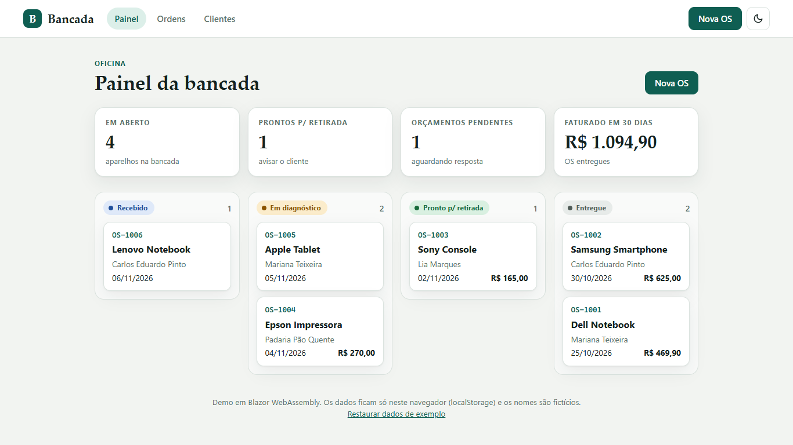
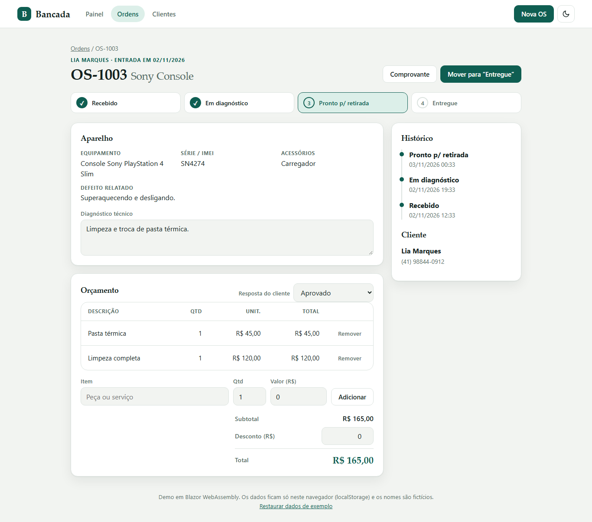
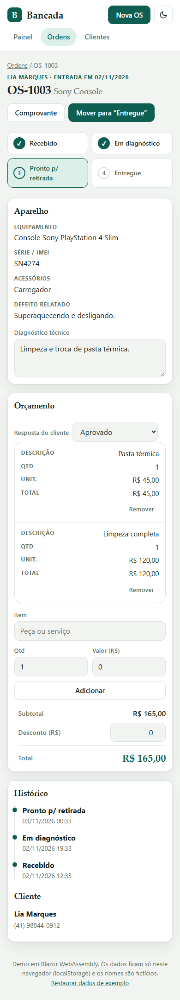
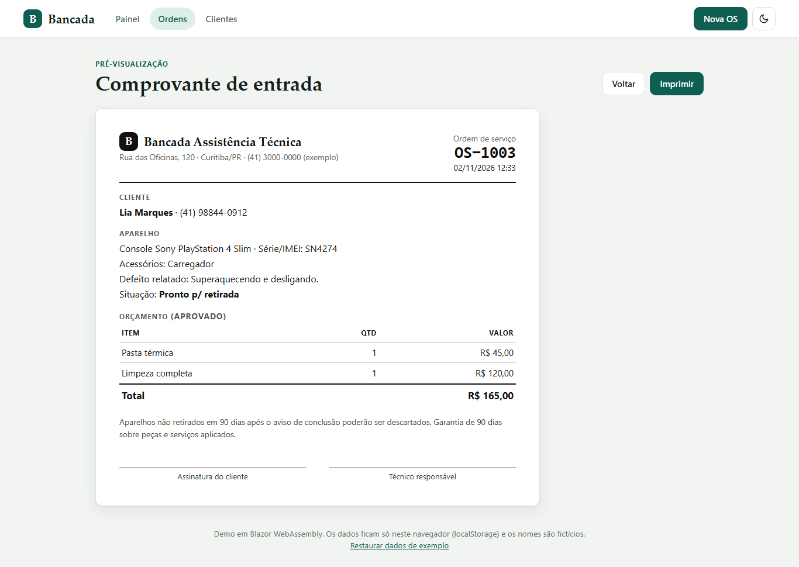

# Bancada — repair shop service orders

A service-order manager for a small electronics repair shop, built with **Blazor WebAssembly (.NET 8)**. It runs entirely in the browser: no backend, no database. Data lives in `localStorage`.

**Live demo:** https://alissonlittig.github.io/bancada-os/



## What it does

- **Open a service order** for a customer (existing or new), with device, brand, model, serial/IMEI, accessories left and reported defect.
- **Track status** through a fixed flow: *Received → Diagnosing → Ready for pickup → Delivered*, with a timestamped history.
- **Build the quote**: line items (part or labour), quantity, unit price, discount (clamped so it never exceeds the subtotal), and the customer's answer (pending / approved / declined).
- **Business rule**: a device can't be delivered while its quote is still waiting for the customer.
- **Print a receipt** (entry slip with signature lines) using a dedicated print stylesheet.
- **Customers** list with order counts, create and edit.
- **Dashboard** with open orders, ready for pickup, pending quotes, 30-day revenue, and a four-column board.
- Light/dark theme, keyboard accessible, responsive down to 390 px with no horizontal scroll.

| Order detail | Mobile | Receipt |
|---|---|---|
|  |  |  |

All people, phone numbers and addresses in the demo data are fictional. "Restore sample data" in the footer resets everything.

## Stack

- C# / Blazor WebAssembly, .NET 8, no JS framework (a few lines of JS for theme and `window.print`)
- State: a single `OrderStore` service persisted as JSON through an `IStorage` abstraction (`BrowserStorage` in the app, `MemoryStorage` in tests)
- Tests: **xUnit** for the domain logic and **bUnit** for the pages (22 tests)
- CI/CD: GitHub Actions restores, builds, runs the tests, publishes and deploys to GitHub Pages

## Project layout

```
src/Bancada/
  Models/     domain types and quote maths (Quote.cs)
  Services/   OrderStore, IStorage
  Pages/      Dashboard, Orders, NewOrder, OrderDetail, Receipt, Customers
  Shared/     StatusBadge, Stepper
  Layout/     MainLayout
tests/Bancada.Tests/   xUnit + bUnit
```

## Run locally

Requires the [.NET 8 SDK](https://dotnet.microsoft.com/download/dotnet/8.0).

```bash
dotnet test
dotnet run --project src/Bancada
```

## Deploy notes

The workflow rewrites `<base href>` to `/bancada-os/` for project Pages and copies `index.html` to `404.html` so deep links such as `/os/<id>` work on refresh.

## License

MIT
